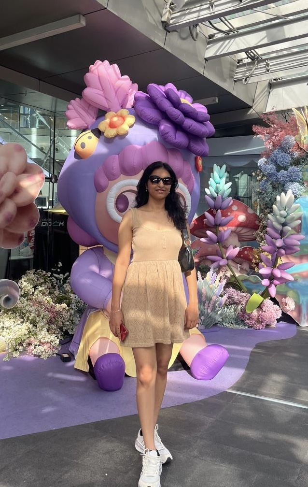

#ABOUT ME
###INTRODUCTION

Hello, my name is Radhika. I am a sophomore at the University of Washington, Seattle. My intended major is Computer Science and I'm currently taking ENGL 396 to learn about Technical Writing.

###CLASSES AND ACADEMIC INTERESTS
####I'm taking the following classes this quarter

- CSE 373: Data Structures and Algorithms

- MATH 208: Linear Algebra
  
- ENGL 396: Software Documentation
  
- JSIS B 497 A: The Global Career Accelerator
  
Currently my favorite class is CSE 373. My favorite part about this class is that it's very theoretical. The Intro to CSE series was mostly writing code and working on projects, which is also fun, but I personally really like studying about what goes behind the surface level concepts. I also like how this class is at an intersection of Math and Computer Science. We talk about real world situations in this class, along with the core concepts. Surprisingly, I used to be nervous during my CSE classes last year. However, after practice, and getting used to the feeling of being lost, I have started liking my current class.
####Academic Interests
Outside of my classes, I really like astrophysics. I love reading wild theories about black holes and the existence of extraterrestrial life. A finding I found really interesting, in particular, was the Sound of Saturn. This voice clip was posted by NASA publicly on their website. The reason I found it interesting was the mystery behind the sound. My speculations had me invested in an article I was reading about how NASA discovered these sounds (Find the link below!) and led me to find out that the sound was actually radio waves! However, people are still unsure about how to interpret the sound, which had me reading about this finding for more than 30 minutes.

[The Sound of Saturn!! Check it out!](https://www.nytimes.com/2017/05/03/science/nasa-cassini-sound-recording-saturn.html?eafs_enabled=false)

###OTHER INTERESTS
I also ***LOVE*** watching movies. My top 3 are listed below!!

| Movie title | Genre |
| :--- | ---: | 
| 1. Interstellar | Sci-Fi Drama |
| 2. 10 things I hate about you | Romantic Comedy |
| 3. La La Land  | Musical, Romance , and Comedy Drama |

